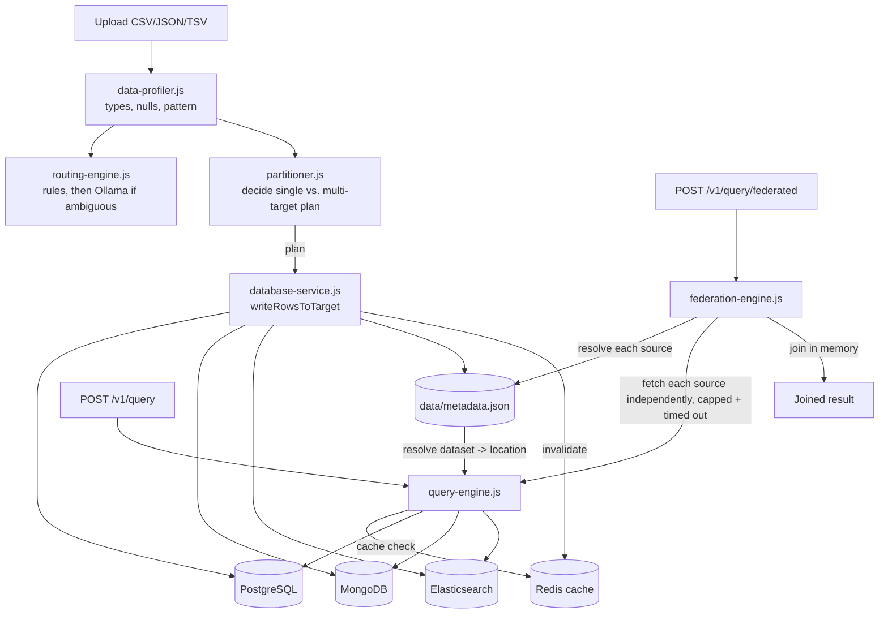
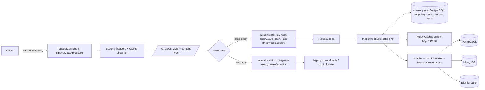

# Architecture

How the pieces fit together. For what's actually built vs. prototype vs.
not-yet-built, see [`IMPLEMENTATION_STATUS.md`](./IMPLEMENTATION_STATUS.md) —
this document describes how the implemented pieces work, not a claim about
their completeness.

## Module map

```
server.js               Express app, all HTTP routes, request validation glue
├── data-profiler.js     Type/null/cardinality/pattern profiling of a CSV/JSON/TSV file
├── routing-engine.js     Deterministic rules + local-Ollama-assisted database recommendation
│   └── gemini-service.js  HTTP client for a LOCAL Ollama instance (no cloud API)
├── partitioner.js        Decides whether/how to split a dataset vertically across databases
├── database-service.js   Safe import execution: identifiers, typed schemas, parameterized
│                         SQL, idempotency, complete metadata (data/metadata.json)
│   └── query-cache.js     Redis-backed cache invalidation hook (see below)
├── query-engine.js       POST /v1/query: dataset resolution, per-database query builders,
│                         cache read/write
│   └── query-cache.js     Cache key, get/set, TTL
├── federation-engine.js  POST /v1/query/federated: two-source join prototype, built on
│                         query-engine.js's single-source execution
├── query-cache.js        Redis client lifecycle, cache key generation, redaction before
│                         writing to Redis, dataset-scoped invalidation
└── redact.js             Shared secret-redaction helper, used by database-service.js,
                          query-engine.js, federation-engine.js, and server.js

public/app.js + views/index.html   Frontend: drives the same pipeline as the API
```

Every module above is plain CommonJS with no framework beyond Express — no
ORM, no query builder library. SQL is built as template strings with
parameterized values; Mongo/ES queries are built as plain JS objects.

## Data flow



## Request lifecycle, stage by stage

### 1. Profile (`POST /profile`)

`data-profiler.js` reads the uploaded file, infers a type per column
(`Boolean`/`Numeric`/`Date`/`Text`/`Object`/`Array`/`Mixed`), computes null
counts and cardinality, and detects a coarse dataset "pattern" (e.g.
log-like, e-commerce-like) used later by the routing rules. Pure, no I/O
beyond reading the uploaded file — no database is touched. See
[`API_PROFILING.md`](./API_PROFILING.md).

### 2. Route (`POST /routing/recommend`)

`routing-engine.js` first checks a fixed set of deterministic rules
(column names/types matching known patterns — timestamps + log level →
Elasticsearch, an `order_id`/`customer_id` shape → PostgreSQL, etc.). If no
rule is confident, it calls a **local** Ollama instance
(`gemini-service.js`) with the profile summary and asks for a
recommendation; if Ollama is unreachable or its response can't be parsed,
it falls back to the best available rule-based guess and says so
explicitly in the response (`source: "fallback"`, reason text naming
Ollama). See [`API_ROUTING.md`](./API_ROUTING.md).

### 3. Partition (`POST /partition/preview`, used internally by `/partition/import`)

`partitioner.js` looks at the profiled columns and decides whether the
dataset should be split vertically (different columns going to different
databases) or imported as a single unit. It also identifies a record
identifier column (or synthesizes one) used later for idempotent
imports and, in federation, as a join key candidate.

### 4. Import (`POST /database/import`, `POST /partition/import`)

`database-service.js`'s `writeRowsToTarget()` is the single place that
knows how to write to each database safely:

- **PostgreSQL** — sanitizes the table/column names, maps profiled types
  to `BIGINT`/`NUMERIC`/`TIMESTAMP`/`BOOLEAN`/`JSONB`/`TEXT`, and inserts
  with parameterized queries (`$1, $2, ...`) inside `CREATE TABLE IF NOT
  EXISTS` + a best-effort unique constraint + `ON CONFLICT DO NOTHING` for
  idempotency.
- **MongoDB** — inserts documents as-is (nested objects/arrays untouched),
  maps a detected identifier column to `_id` when present so re-imports
  are idempotent, and uses `insertMany(..., { ordered: false })` so one
  bad document doesn't fail the whole batch.
- **Elasticsearch** — checks whether the index exists before creating it,
  bulk-indexes with `refresh: true`, and inspects the bulk response
  per-document to report partial failures instead of an all-or-nothing
  result.

Every import writes a complete metadata record (dataset name, upload
time, file type, row count, target database, resolved table/collection/
index name, schema, partition info, status, error details) to
`data/metadata.json`, and — on success — calls `query-cache.js`'s
`invalidateDataset()` so any previously cached `/v1/query` results for
that dataset are cleared.

### 5. Query (`POST /v1/query`)

`query-engine.js` resolves a dataset name to the database it actually
lives in by reading `data/metadata.json` — it does not re-run the routing
engine at query time. If the same dataset lives in more than one database
(because it was partitioned), the caller must specify `targetDatabase`
explicitly; there's no cross-database query without going through
federation. Before running anything, it checks the Redis cache
(`query-cache.js`) using a key built from
`{dataset, queryType, conditions, sort, limit, targetDatabase}`; on a
miss, it builds and runs a parameterized SQL query (Postgres), a
whitelisted-operator filter object (Mongo), or a structured Query DSL body
(Elasticsearch), then caches a successful result before returning it. See
[`API_QUERY.md`](./API_QUERY.md) and [`API_CACHING.md`](./API_CACHING.md).

### 6. Federate (`POST /v1/query/federated`, prototype)

`federation-engine.js` resolves exactly two sources the same way
`query-engine.js` does, fetches each independently (each capped at
`FEDERATION_MAX_SOURCE_ROWS`, the whole fetch stage bounded by
`FEDERATION_TIMEOUT_MS`), and performs a plain in-memory hash join
(`inner`/`left` only) using join fields the caller must supply explicitly.
See [`API_FEDERATION.md`](./API_FEDERATION.md), including its Limitations
section — this stage is explicitly a prototype, not a query planner.

## Error-handling shape

Two different kinds of failure are represented differently throughout the
whole system, on purpose:

- **Bad input** (unknown dataset, invalid operator, malformed file,
  unsupported join type, an unresolvable ambiguous dataset) → a thrown
  `*ValidationError` (`ImportValidationError`, `QueryValidationError`,
  `FederationValidationError`, `ProfilingValidationError`) → HTTP `400`
  with a specific, actionable message. The request never touched a
  database.
- **A database/service actually failing** (connection refused, a query
  erroring, Elasticsearch partially failing a bulk request) → caught at
  the point of the call and returned as part of a normal `200` response
  with `status: "error"` (or `"partial"`) and details in `message`/
  `errors`. The HTTP layer isn't used to signal this because the request
  itself was valid — the failure is a fact about the world, not the
  request.

Every message that could plausibly have come from a raw driver error
passes through `redact.js`'s `redactSensitive()` before it's returned or
cached, stripping anything shaped like embedded credentials
(`user:pass@host`) or a `password=`/`secret=`/`token=`-style assignment —
see `README.md`'s Frontend section and `API_CACHING.md`'s security note.

## Testing shape

Three tiers, described fully in [`QUICK_START.md`](./QUICK_START.md) and
[`IMPLEMENTATION_STATUS.md`](./IMPLEMENTATION_STATUS.md):

1. **Unit tests** (`tests/*.test.js` excluding `workflow.integration` and
   `negative`) — pure logic, mocked drivers, no I/O.
2. **Mocked HTTP integration** (`tests/workflow.integration.test.js`,
   `tests/negative.test.js`) — real Express routing and real `multer`
   file handling via `supertest`, with `pg`/`mongodb`/
   `@elastic/elasticsearch`/`redis` mocked at the module boundary.
3. **Real-service integration** (`tests/integration/*.test.js`) — no
   mocking at all; talks to actual local Docker services (and local
   Ollama), each guarded by a live connectivity probe that soft-skips the
   suite with a clear console notice if its service isn't running.

## Why "gemini-service.js" only ever calls Ollama

The filename is historical. Every network call this module makes targets
`OLLAMA_HOST:OLLAMA_PORT` over plain HTTP — there is no code path to
Google's Gemini API or any other cloud LLM provider anywhere in this
repository. `GEMINI_API_KEY`, if present in an older `.env`, is not read
by any module (see `ENVIRONMENT.md`).


## Request pipeline & DBaaS data path (1.0)

Tenant chain: key → projectId → collection → mapping(projectId, collection) → adapter → physical store; Redis keys start with the projectId.
Failure behaviour: Redis down → cache bypass; backend down → breaker opens, 503 + Retry-After; control plane down → `/ready` 503, requests 503.
